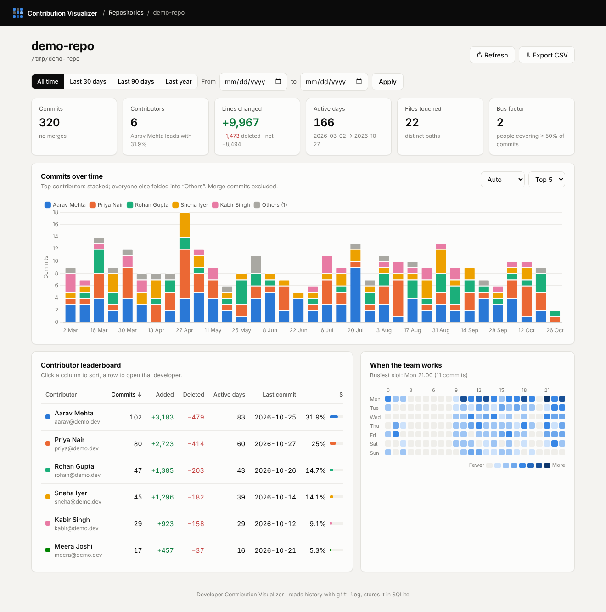
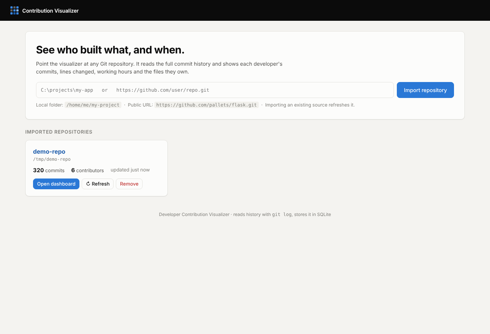
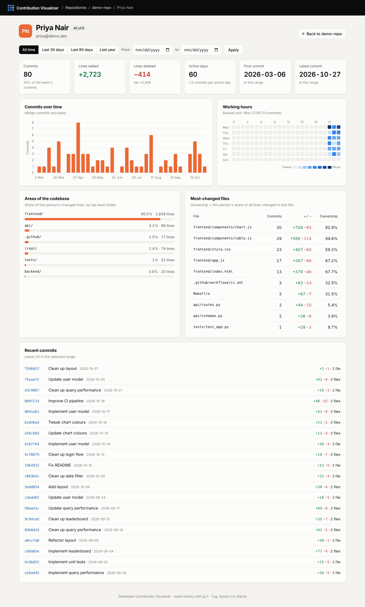
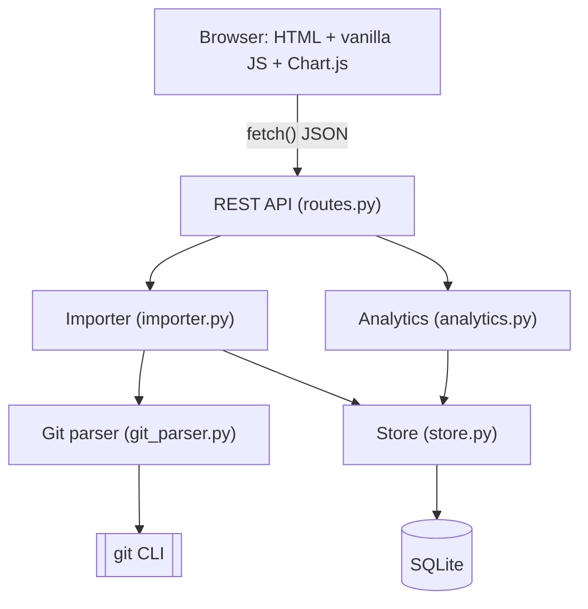

# Developer Contribution Visualizer

> CBCA321 course project. Deliverable 1 (problem understanding) is
> `1. Problem understanding.pdf` in this folder; Assessments 2 and 3 are in `output/`.

A web dashboard that reads the history of any Git repository (a folder on your
laptop or a public Git URL) and shows **who contributed what, when, and where**:
commits and lines per developer, activity over time, the hours the team works,
the files each person owns, and how dependent the project is on a few people.



---

## Features

| Feature | What it does |
|---|---|
| **Import a repository** | Paste a local path (any sub-folder works) or a public Git URL (`https://`, `git@`, `ssh://`). **Only metadata is stored**: local folders are read in place, and URLs are read from a temporary bare clone that is deleted straight after import. |
| **Incremental refresh** | Only commits after the last imported one are parsed. If history was rewritten (force-push), the repo is rebuilt automatically. |
| **Summary tiles** | Commits, contributors, lines added/deleted, active days, files touched, **bus factor**. |
| **Commits over time** | Stacked bar chart of the top 3/5/8 contributors (rest folded into “Others”), daily/weekly/monthly or automatic buckets. |
| **Contributor leaderboard** | Sortable by commits, lines added, lines deleted, active days, last commit, name. Shows each person's share. |
| **Activity heatmap** | 7 × 24 grid of commits by weekday and hour, in the author's own timezone. |
| **Contributor drill-down** | Rank, personal stats, timeline, working hours, folders worked on, most-changed files with **ownership %**, latest 20 commits. |
| **Date-range filter** | Presets (30 days / 90 days / 1 year, counted back from the last commit) or custom dates. Kept in the URL, so filtered views can be shared and survive page changes. |
| **CSV export** | Leaderboard for the selected range as a spreadsheet. |

Merge commits are excluded from counts (they carry no line changes). Contributors
are grouped by e-mail (case-insensitive) and respect the repository's `.mailmap`.

## Screenshots

| Home | Contributor page |
|---|---|
|  |  |

---

## Getting started

Requirements: **Python 3.10+** and **Git** on your PATH.

```bash
git clone https://github.com/surajprashant/CBCA321LAB.git
cd CBCA321LAB/Project
python3 -m venv .venv
# Windows: .venv\Scripts\activate      macOS/Linux: source .venv/bin/activate
pip install -r requirements.txt
python3 run.py
```

Open **http://127.0.0.1:5000** and import a repository.

**Try it with demo data** (6 developers, 320 commits over 8 months, always the same):

```bash
python3 scripts/make_demo_repo.py demo-repo
```

Then import the printed path. You can also import this project's own folder to
visualise your own commit history.

**Run the tests**

```bash
python3 -m pytest -v
```

**Check the performance requirement** (10,000 commits in under 5 s):

```bash
python3 scripts/benchmark.py
```

Settings (optional environment variables): `DCV_DATABASE` (SQLite file, default
`data/dcv.db`), `DCV_CLONE_DIR` (temporary clone area, default `data/tmp`), `PORT` (default 5000).

---

## Architecture

Layered (3-tier) client–server design. Each layer only talks to the one below it.



```
app/
  __init__.py      Flask app factory, wires the services together
  git_parser.py    runs `git log --numstat`, parses output into Commit objects
  db.py            SQLite schema
  store.py         data-access layer (all writes)
  importer.py      import / temporary clone / incremental refresh / delete
  analytics.py     summary, leaderboard, timeline, heatmap, drill-down, CSV
  routes.py        page routes + REST API
  templates/       Jinja pages
  static/          CSS, JS, bundled Chart.js (works offline)
scripts/make_demo_repo.py   reproducible demo repository
scripts/benchmark.py        10,000-commit performance check
tests/                      pytest suite (unit + API)
output/                     assessment documents and LLM interaction log
```

### REST API

| Method | Endpoint | Notes |
|---|---|---|
| GET | `/api/repos` | all repositories |
| POST | `/api/repos` | body `{"source": "<path or URL>"}` → `201` new, `200` already imported (refreshed) |
| POST | `/api/repos/<id>/refresh` | `{repository, new_commits}` |
| DELETE | `/api/repos/<id>` | removes stored metadata; never touches your own folders |
| GET | `/api/repos/<id>/summary` | `?since=YYYY-MM-DD&until=YYYY-MM-DD` |
| GET | `/api/repos/<id>/contributors` | `&sort=commits\|additions\|deletions\|active_days\|last_day\|name` |
| GET | `/api/repos/<id>/timeline` | `&granularity=auto\|day\|week\|month&top=1..8` |
| GET | `/api/repos/<id>/heatmap` | `&contributor_id=` optional |
| GET | `/api/repos/<id>/contributors/<cid>` | drill-down |
| GET | `/api/repos/<id>/export.csv` | CSV download |

Errors are always JSON: `{"error": "message"}` with status 400 or 404.

### Tech stack

Python 3 · Flask 3 · SQLite (`sqlite3`) · Git CLI via `subprocess` · Chart.js 4
(bundled) · HTML/CSS/vanilla JS · pytest.

---

## Testing

95 tests in four files, all running on throwaway Git repositories with known
authors, dates and line counts, so every number on the dashboard is checked
against a hand-calculated answer.

| File | Covers |
|---|---|
| `test_git_parser.py` | rename paths, binary files, malformed log records, empty repos, `since_sha` |
| `test_store_and_importer.py` | contributor merging by e-mail, idempotent saves, cascade delete, URL detection, incremental refresh, history rewrite, **no source code left after URL import**, bad input |
| `test_analytics.py` | bus factor, bucketing, summary, filters, sort whitelist, stable colours, timeline “Others”, heatmap cells, ownership %, CSV formula-injection guard |
| `test_api.py` | every endpoint, status codes, validation errors, page rendering |

---

## Learnings

### Assessment 2: design and first deliverable
- **Write the interface before the code.** Writing the method signatures in
  `Assessment-2.md` first made implementation mostly “fill in the boxes”, and the
  tests could be written against the same signatures.
- **Separate the pure part from the I/O part.** `parse_log()` takes a string and
  returns objects, so most parser tests need no Git repository at all. Only a few
  tests run real `git` commands.
- **Parse once, query many times.** Running `git log` on every page view would be
  slow for large repos. Storing parsed commits in SQLite lets the dashboard use
  SQL `GROUP BY` for every chart.
- **Git output has edge cases.** Renamed files appear as `src/{old => new}/a.py`,
  binary files as `-  -`, and the same person can commit as `Alice@X.com` and
  `alice@x.com`. Each of these became a test case.

### Assessment 3: features in depth
- **Depth over breadth.** Instead of many half-finished charts, the import →
  analytics → dashboard → drill-down path works end to end, with filters,
  refresh and export built on the same API.
- **Requirements can conflict.** Deliverable 1 asked for both “fetch via the Git
  API” and “10,000 commits in under 5 s”. GitHub needs one API call per commit to
  get line counts, so both can't hold at once. Reading a temporary bare clone and
  deleting it straight away keeps the security rule (no stored source code) and
  passes the benchmark (10,000 commits in about 3 s; Flask's 5,566 commits from
  GitHub in about 4 s).
- **Incremental refresh needs a fallback.** Reading only `last_sha..HEAD` is fast,
  but if someone force-pushes, the old SHA disappears. `git merge-base
  --is-ancestor` detects this and the repo is rebuilt from scratch.
- **SQLite `AUTOINCREMENT` + upsert wastes ids.** `INSERT … ON CONFLICT DO UPDATE`
  used up an id on every commit, so contributor ids jumped (1, 2, 3, 10, 17…).
  Checking for the row first and then inserting or updating fixed it, and a test
  now guards it.
- **Ambiguous columns.** `ORDER BY additions` failed once two joined tables both
  had an `additions` column. The failing test pointed straight at it.
- **Security even in a small project.** User input goes to `git` as a list (no
  shell), sources starting with `-` are rejected (stops `--upload-pack=…`
  argument injection), clones never prompt for passwords, and CSV cells starting
  with `=`, `+`, `-` or `@` are escaped so Excel doesn't run them as formulas.
- **Charts need rules.** A person keeps the same colour when the date filter
  changes (colour = all-time rank, not filtered rank), the palette was checked
  for colour-blind separation, and the heatmap uses one colour from light to
  dark.
- **CSS grid overflow.** The heatmap pushed its card off-screen until grid
  children got `min-width: 0`. Checking real screenshots caught what tests
  couldn't.

### Next steps
- GitHub API import (pull requests, reviews, issues) using a personal token.
- Alias merging in the UI (same person, two e-mails).
- Compare two contributors or two time periods side by side.
