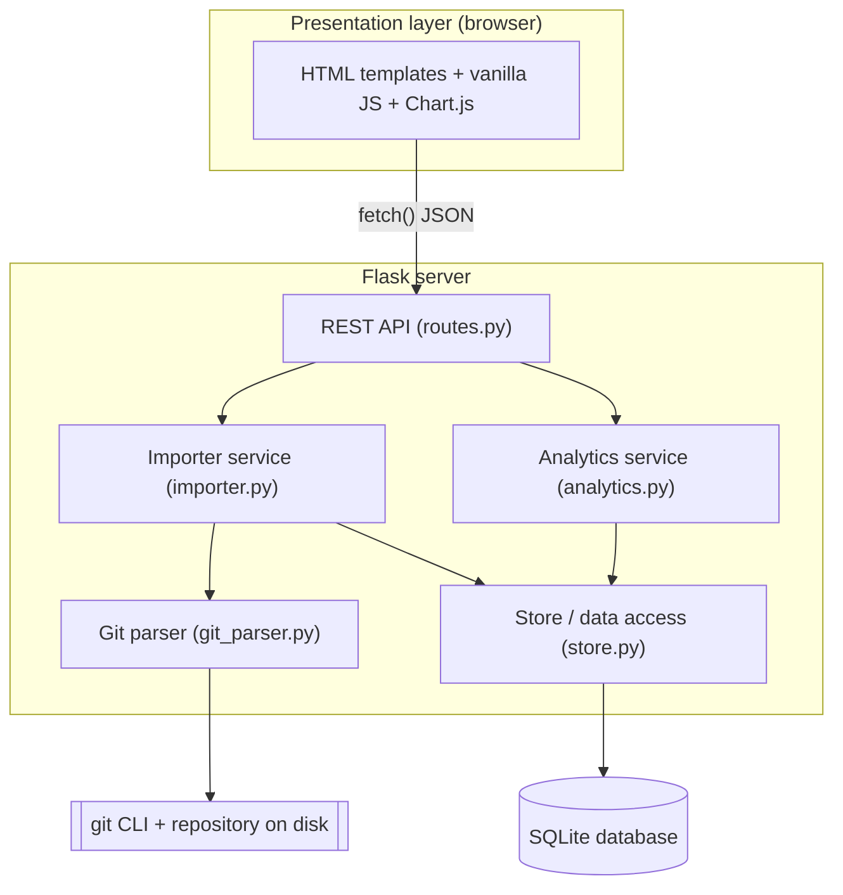

# Assessment 2 — Architecture & First Deliverable

## 1. Project title and description

**Developer Contribution Visualizer**

A web application that reads the history of any Git repository (a folder on your
laptop or a public Git URL) and turns it into an interactive dashboard showing
*who contributed what, when, and where*. It answers questions that are hard to
answer from `git log` alone:

- Who are the most active contributors, and how is the work shared?
- How has activity changed over time?
- When (day of week / hour) does the team actually work?
- Which files and folders does each developer own?
- How dependent is the project on one or two people (bus factor)?

## 2. Major components

| Layer | Component | Responsibility |
|---|---|---|
| **UI** | Home page | List imported repositories, form to import a new one |
| | Repository dashboard | Summary cards, contributor leaderboard, commit timeline, activity heatmap, date filter, CSV export |
| | Contributor page | One developer's stats, timeline, heatmap, top files/folders, recent commits |
| **Logic** | Git parser | Runs `git log --numstat` and converts output into commit objects |
| | Importer service | Validates the source, clones URLs, runs the parser, saves results, handles refresh |
| | Analytics service | Aggregates commits into summaries, leaderboards, timelines, heatmaps, ownership |
| | REST API | JSON endpoints that the UI calls |
| **Persistence** | SQLite store | Tables for repositories, contributors, commits, file changes |
| | Clone cache | `data/clones/` folder holding cloned remote repositories |

## 3. Architecture

A **layered (3-tier) client–server architecture** with a REST API between the
browser and the server. Each layer only talks to the layer directly below it,
which keeps the parsing, the maths and the storage separately testable.



**Why this architecture fits:**
- Importing is slow (parse once), viewing is fast (query many times), so we
  persist parsed data in a database instead of re-running `git log` per page view.
- A JSON API lets the same data feed the dashboard, the CSV export, and later a
  CLI or a GitHub integration without changing the logic layer.
- It runs as one process on a laptop with no external services, which suits a demo.

## 4. Minimal feature set for the first deliverable (4 days)

| # | Feature | Done when |
|---|---|---|
| F1 | **Import a repository** from a local path or Git URL | Repo appears in the list with commit/contributor counts |
| F2 | **Contributor leaderboard** | Table of contributors with commits, lines added/deleted, active days, share % |
| F3 | **Commit timeline** | Stacked bar chart of commits over time for the top contributors |
| F4 | **Activity heatmap** | 7 × 24 grid of commits by weekday and hour |
| F5 | **Contributor drill-down** | Page per developer with their own stats and top files |

Stretch (Assessment 3): date-range filter, incremental refresh, CSV export,
bus factor, folder ownership.

## 5. Users who benefit

| User | Benefit |
|---|---|
| **Project managers / team leads** | See workload distribution and spot overloaded or inactive members |
| **Course instructors / evaluators** | Check that every student in a group project actually contributed |
| **Open-source maintainers** | Identify core contributors and knowledge silos (bus factor) |
| **Individual developers** | Review and showcase their own contribution history |

## 6. Components of the first deliverable

1. `git_parser.py` — Git log parser
2. `store.py` + `db.py` — SQLite persistence
3. `importer.py` — Import service
4. `analytics.py` — Analytics service
5. `routes.py` — REST API + page routes
6. `templates/` + `static/` — Dashboard UI

## 7. Component interfaces

### 7.1 Git parser (`app/git_parser.py`)
```python
@dataclass
class FileChange:  path: str; additions: int; deletions: int; is_binary: bool
@dataclass
class Commit:      sha, author_name, author_email, authored_at (datetime, author tz),
                   parents: list[str], message: str, files: list[FileChange]

def is_git_repo(path: str) -> bool
def head_sha(path: str) -> str | None
def read_commits(path: str, since_sha: str | None = None) -> list[Commit]
def parse_log(raw: str) -> list[Commit]        # pure function, unit-tested
def normalize_path(path: str) -> str           # handles "a/{old => new}/f.py" renames
```

### 7.2 Store (`app/store.py`)
```python
class Store:
    def __init__(self, db_path: str)
    def create_repository(name, source, path, head_sha) -> int
    def get_repository(repo_id) -> dict | None
    def find_repository_by_source(source) -> dict | None
    def list_repositories() -> list[dict]
    def delete_repository(repo_id) -> None
    def save_commits(repo_id, commits: list[Commit]) -> int
    def update_head(repo_id, head_sha) -> None
    def query(sql, params) -> list[dict]       # used by analytics
```

### 7.3 Importer (`app/importer.py`)
```python
class Importer:
    def __init__(self, store: Store, clone_dir: str)
    def import_source(source: str) -> dict      # local path or URL → repository dict
    def refresh(repo_id: int) -> dict           # incremental: only new commits
class ImportError_(Exception)                   # bad path, bad URL, git failure
```

### 7.4 Analytics (`app/analytics.py`)
```python
class Analytics:
    def __init__(self, store: Store)
    def summary(repo_id, since=None, until=None) -> dict
    def leaderboard(repo_id, since=None, until=None, sort="commits") -> list[dict]
    def timeline(repo_id, since=None, until=None, granularity="auto", top=5) -> dict
    def heatmap(repo_id, contributor_id=None, since=None, until=None) -> list[list[int]]
    def contributor_detail(repo_id, contributor_id, since=None, until=None) -> dict
    def export_csv(repo_id, since=None, until=None) -> str
```

### 7.5 REST API (`app/routes.py`)

| Method | Endpoint | Body / query | Response |
|---|---|---|---|
| GET | `/api/repos` | – | `[repository]` |
| POST | `/api/repos` | `{"source": "<path or url>"}` | `201 repository` / `400 {error}` |
| POST | `/api/repos/<id>/refresh` | – | `{repository, new_commits}` |
| DELETE | `/api/repos/<id>` | – | `204` |
| GET | `/api/repos/<id>/summary` | `since, until` | summary object |
| GET | `/api/repos/<id>/contributors` | `since, until, sort` | leaderboard rows |
| GET | `/api/repos/<id>/timeline` | `since, until, granularity, top` | `{labels, series[]}` |
| GET | `/api/repos/<id>/heatmap` | `contributor_id, since, until` | 7×24 matrix |
| GET | `/api/repos/<id>/contributors/<cid>` | `since, until` | contributor detail |
| GET | `/api/repos/<id>/export.csv` | `since, until` | CSV file |

Dates are `YYYY-MM-DD`. Errors are always `{"error": "message"}` with a 4xx code.

### 7.6 Database schema

```mermaid
erDiagram
    REPOSITORIES ||--o{ CONTRIBUTORS : has
    REPOSITORIES ||--o{ COMMITS : has
    CONTRIBUTORS ||--o{ COMMITS : authors
    COMMITS ||--o{ FILE_CHANGES : touches
    REPOSITORIES { int id PK; text name; text source; text path; text head_sha; text imported_at }
    CONTRIBUTORS { int id PK; int repo_id FK; text email; text name }
    COMMITS { int id PK; int repo_id FK; int contributor_id FK; text sha; int ts; int weekday; int hour; int additions; int deletions; int is_merge; text message }
    FILE_CHANGES { int id PK; int commit_id FK; text path; int additions; int deletions; int is_binary }
```

## 8. Tech stack

| Concern | Choice | Reason |
|---|---|---|
| Language | **Python 3.10+** | Simple subprocess + data handling, good test tooling |
| Web framework | **Flask 3** | Lightweight, built-in test client |
| Database | **SQLite** (Python `sqlite3`) | Zero setup, single file, real SQL aggregates |
| Git access | **git CLI** via `subprocess` | Reads any repo (local or cloned), respects `.mailmap` |
| Charts | **Chart.js 4** (bundled locally) | Works offline during the demo |
| Frontend | HTML, CSS, vanilla JavaScript | No build step |
| Testing | **pytest**, Flask test client | Unit + API tests on throwaway Git repos |
| Tools | Git, GitHub, VS Code | Version control and hosting |
